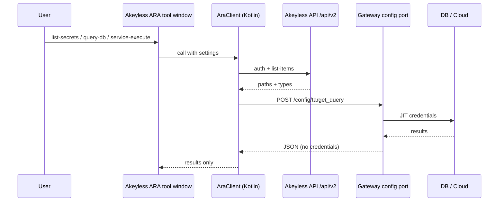

# Akeyless ARA Plugin for JetBrains IDEs (PyCharm)

Native JetBrains plugin that brings
[Akeyless Agentic Runtime Authority (ARA)](https://docs.akeyless.io/docs/agentic-runtime-authority)
to **PyCharm**, IntelliJ IDEA, WebStorm, and other IntelliJ-based IDEs.

The IDE orchestrates. Akeyless holds the credentials. **Secret values never enter the UI or logs.**

This matches the tools and auth model of the
[Claude Desktop connector](https://github.com/akeyless-community/claude-akeyless-connector),
implemented in Kotlin — **no Akeyless CLI or Node required** for core use.

> Related (different product): the [Akeyless MCP plugin](https://github.com/akeyless-community/akeyless-mcp-plugin)
> browses secrets via the CLI MCP server. This ARA plugin executes `list-secrets` / `query-db` /
> `service-execute` through the Gateway with JIT credentials.

## Features

- **list-secrets** — discover ARA-enabled dynamic, rotated, and custom-MCP secrets
- **query-db** — run database queries via Gateway JIT credentials
- **service-execute** — AWS, GCP, Azure, Kubernetes, GitHub, or custom MCP actions
- **list-sub-tools** — discover sub-tools for a service secret
- **Settings UI** — Gateway URL + auth method (Access Key / JWT stored in PasswordSafe)
- **SAML / OIDC** — browser login on first use

## Requirements

- JetBrains IDE 2024.3 or later (PyCharm, IntelliJ IDEA, etc.)
- JDK 17 or higher to **build** from source
- Akeyless Gateway with ARA configured
- Network access to your Gateway

## Installation

### From source (Marketplace-style ZIP)

```bash
git clone https://github.com/akeyless-community/pycharm-ara-plugin.git
cd pycharm-ara-plugin
./gradlew buildPlugin
```

Then in the IDE:

1. **Settings → Plugins → ⚙ → Install Plugin from Disk…**
2. Select the ZIP from `build/distributions/`
3. Restart when prompted
4. Ensure the plugin is **enabled**

### Development sandbox

```bash
./gradlew runIde
```

## Configuration

**Settings → Tools → Akeyless ARA**  
(or **Tools → Akeyless ARA Settings…**)

| Field | Notes |
|---|---|
| Gateway URL | e.g. `https://gw.example.com:8000/api/v2` |
| Authentication Method | `access_key` (default), `saml`, `oidc`, `universal_identity`, `jwt` |
| Access ID | Required for access_key, saml, oidc, jwt |
| Access Key | Required for access_key — stored in PasswordSafe |
| UID Token File | Required for universal_identity (default `~/.akeyless/uid_rotator/uid-token`) |
| JWT | Required for jwt — stored in PasswordSafe |
| Agent ID | ARA audit id (default `pycharm`) |
| Default secret path | Optional |

Cloud IAM (`aws_iam` / `azure_ad` / `gcp`) is deferred to a later release.

### SAML / OIDC

The first authenticated call opens your browser. Complete IdP login; the plugin receives the callback on `127.0.0.1`.

## Usage

1. Open **Tools → Show Akeyless ARA** (or **View → Tool Windows → Akeyless ARA**)
2. Click **Refresh secrets**
3. Use **Query DB**, **Service Execute**, or **List Sub-Tools** tabs

### OAuth-backed secrets

If a call returns an authorization URL, open it, then paste **auth-code** (state is pre-filled) and retry.

## Architecture



## Build & test

```bash
./gradlew check
./gradlew buildPlugin
```

## Publishing to JetBrains Marketplace

See [PUBLISHING.md](PUBLISHING.md).

## Project structure

```
pycharm-ara-plugin/
├── src/main/kotlin/com/akeyless/ara/
│   ├── client/          # ARA HTTP client (auth, list, query, execute)
│   ├── settings/        # Settings + PasswordSafe
│   ├── ui/              # Tool window
│   ├── actions/         # Tools menu actions
│   └── icons/
├── src/main/resources/META-INF/
│   ├── plugin.xml
│   └── pluginIcon.*
├── src/test/kotlin/
├── PUBLISHING.md
└── build.gradle.kts
```

## Related

- [Claude ARA connector](https://github.com/akeyless-community/claude-akeyless-connector)
- [Cursor ARA connector](https://github.com/akeyless-community/cursor-akeyless-connector)
- [Akeyless MCP JetBrains plugin](https://github.com/akeyless-community/akeyless-mcp-plugin) (secrets browser)

## License

MIT — see [LICENSE](LICENSE).

## Support

- Plugin issues: https://github.com/akeyless-community/pycharm-ara-plugin/issues
- Akeyless docs: https://docs.akeyless.io/docs/agentic-runtime-authority
